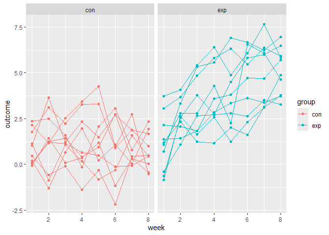

iteration_and_listcols
================

## Lists

``` r
library(tidyverse)
```

    ## ── Attaching core tidyverse packages ──────────────────────── tidyverse 2.0.0 ──
    ## ✔ dplyr     1.2.1     ✔ readr     2.2.0
    ## ✔ forcats   1.0.1     ✔ stringr   1.6.0
    ## ✔ ggplot2   4.0.3     ✔ tibble    3.3.1
    ## ✔ lubridate 1.9.5     ✔ tidyr     1.3.2
    ## ✔ purrr     1.2.2     
    ## ── Conflicts ────────────────────────────────────────── tidyverse_conflicts() ──
    ## ✖ dplyr::filter() masks stats::filter()
    ## ✖ dplyr::lag()    masks stats::lag()
    ## ℹ Use the conflicted package (<http://conflicted.r-lib.org/>) to force all conflicts to become errors

``` r
library(rvest)
```

    ## 
    ## 载入程序包：'rvest'
    ## 
    ## The following object is masked from 'package:readr':
    ## 
    ##     guess_encoding

``` r
set.seed(1)
```

In R, vectors are limited to a single data class – all elements are
characters, or all numeric, or all logical. Trying to join the following
vectors will result in coersion, as would creating vectors of mixed
types.

``` r
vec_numeric = 5:8
vec_char = c("My", "name", "is", "Jeff")
vec_logical = c(TRUE, TRUE, TRUE, FALSE)
```

Lists contain indexed elements, and the indexed elements themselves be
scalars, vectors, or other things entirely.

``` r
l = list(
  vec_numeric = 5:8,
  mat         = matrix(1:8, 2, 4),
  vec_logical = c(TRUE, FALSE),
  summary     = summary(rnorm(1000)))
l
```

    ## $vec_numeric
    ## [1] 5 6 7 8
    ## 
    ## $mat
    ##      [,1] [,2] [,3] [,4]
    ## [1,]    1    3    5    7
    ## [2,]    2    4    6    8
    ## 
    ## $vec_logical
    ## [1]  TRUE FALSE
    ## 
    ## $summary
    ##     Min.  1st Qu.   Median     Mean  3rd Qu.     Max. 
    ## -3.00805 -0.69737 -0.03532 -0.01165  0.68843  3.81028

Lists can be accessed using names or indices, and the things in lists
can be accessed in the way you would usually access an object of that
type.

``` r
l$vec_numeric
```

    ## [1] 5 6 7 8

``` r
l[[1]]
```

    ## [1] 5 6 7 8

``` r
l[[1]][1:3]
```

    ## [1] 5 6 7

## *for* loop

``` r
list_norms = 
  list(
    a = rnorm(20, 3, 1),
    b = rnorm(20, 0, 5),
    c = rnorm(20, 10, .2),
    d = rnorm(20, -3, 1)
  )

is.list(list_norms)
```

    ## [1] TRUE

``` r
mean_and_sd = function(x) {
  
  if (!is.numeric(x)) {
    stop("Argument x should be numeric")
  } else if (length(x) == 1) {
    stop("Cannot be computed for length 1 vectors")
  }
  
  mean_x = mean(x)
  sd_x = sd(x)

  tibble(
    mean = mean_x, 
    sd = sd_x
  )
}
```

We can apply the `mean_and_sd` function to each element of `list_norms`
using the lines below.

``` r
mean_and_sd(list_norms[[1]])
```

    ## # A tibble: 1 × 2
    ##    mean    sd
    ##   <dbl> <dbl>
    ## 1  2.70  1.12

``` r
mean_and_sd(list_norms[[2]])
```

    ## # A tibble: 1 × 2
    ##    mean    sd
    ##   <dbl> <dbl>
    ## 1 0.416  4.08

``` r
mean_and_sd(list_norms[[3]])
```

    ## # A tibble: 1 × 2
    ##    mean    sd
    ##   <dbl> <dbl>
    ## 1  10.1 0.191

``` r
mean_and_sd(list_norms[[4]])
```

    ## # A tibble: 1 × 2
    ##    mean    sd
    ##   <dbl> <dbl>
    ## 1 -3.43  1.18

Below, I define an output list with the same number of entries as my
target dataframe; a sequence to iterate over; and a `for` loop body that
applies the `mean_and_sd` function for each sequence element and saves
the result.

``` r
output = vector("list", length = 4)

for (i in 1:4) {
  output[[i]] = mean_and_sd(list_norms[[i]])
}
output
```

    ## [[1]]
    ## # A tibble: 1 × 2
    ##    mean    sd
    ##   <dbl> <dbl>
    ## 1  2.70  1.12
    ## 
    ## [[2]]
    ## # A tibble: 1 × 2
    ##    mean    sd
    ##   <dbl> <dbl>
    ## 1 0.416  4.08
    ## 
    ## [[3]]
    ## # A tibble: 1 × 2
    ##    mean    sd
    ##   <dbl> <dbl>
    ## 1  10.1 0.191
    ## 
    ## [[4]]
    ## # A tibble: 1 × 2
    ##    mean    sd
    ##   <dbl> <dbl>
    ## 1 -3.43  1.18

## *map*

A criticism of for loops is that there’s a lot of overhead – you have to
define your output vector / list, there’s the for loop bookkeeping to
do, etc – that distracts from the purpose of the code. In this case, we
want to apply mean_and_sd to each element of list_norms, but we have to
scan inside the for loop to figure that out.

The map functions in purrr try to make the purpose of your code clear.
Compare the loop above to the line below.

``` r
output = map(list_norms, mean_and_sd) |>
  print()
```

    ## $a
    ## # A tibble: 1 × 2
    ##    mean    sd
    ##   <dbl> <dbl>
    ## 1  2.70  1.12
    ## 
    ## $b
    ## # A tibble: 1 × 2
    ##    mean    sd
    ##   <dbl> <dbl>
    ## 1 0.416  4.08
    ## 
    ## $c
    ## # A tibble: 1 × 2
    ##    mean    sd
    ##   <dbl> <dbl>
    ## 1  10.1 0.191
    ## 
    ## $d
    ## # A tibble: 1 × 2
    ##    mean    sd
    ##   <dbl> <dbl>
    ## 1 -3.43  1.18

``` r
output = vector("list", length = 4)

for (i in 1:4) {
  output[[i]] = median(list_norms[[i]])
}

output = map(list_norms, median)
```

Again, both options produce the same output, but the map places the
focus squarely on the function you want to apply by removing much of the
bookkeeping

## *map* variants

There are some useful variants to the basic map function if you know
what kind of output you’re going to produce. Below we use map_dbl
because median outputs a single numeric value each time; the result is a
vector instead of a list. Using the .id argument keeps the names of the
elements in the input list.

``` r
output = map_dbl(list_norms, median, .id = "input")
```

If we tried to use map_int or map_lgl, we’d get an error because the
output of median isn’t a integer or a logical. This is a good way to
help catch mistakes when they arise.

Similarly, since we know mean_and_sd produces a data frame, we can use
the output-specific map_dfr; this will produce a single data frame.

``` r
output = map_dfr(list_norms, mean_and_sd, .id = "input")
```

The map_df variants can be helpful when your map statement is part of a
longer chain of piped commands.

Lastly, the variant map2 (and map2_dbl, etc) is helpful when your
function has two arguments. In these cases, I find it best to be
specific about arguments using something like the following (more on
anonymous functions shortly):

## List columns and operations

``` r
listcol_df = 
  tibble(
    name = c("a", "b", "c", "d"),
    samp = list_norms
  )
```

The name column is a character column – if you pull this column from the
listcol_df data frame, the result is a character vector. Similarly, the
samp column is a list column – on it’s own, it’s a list.

``` r
listcol_df |> pull(name)
```

    ## [1] "a" "b" "c" "d"

``` r
listcol_df |> pull(samp)
```

    ## $a
    ##  [1] 4.134965 4.111932 2.129222 3.210732 3.069396 1.337351 3.810840 1.087654
    ##  [9] 1.753247 3.998154 2.459127 2.783624 1.378063 1.549036 3.350910 2.825453
    ## [17] 2.408572 1.665973 1.902701 5.036104
    ## 
    ## $b
    ##  [1] -1.63244797  3.87002606  3.92503200  3.81623040  1.47404380 -6.26177962
    ##  [7] -5.04751876  3.75695597 -6.54176756  2.63770049 -2.66769787 -1.99188007
    ## [13] -3.94784725 -1.15070568  4.38592421  2.26866589 -1.16232074  4.35002762
    ## [19]  8.28001867 -0.03184464
    ## 
    ## $c
    ##  [1] 10.094098 10.055644  9.804419  9.814683 10.383954 10.176256 10.148416
    ##  [8] 10.029515 10.097078 10.030371 10.008400 10.044684  9.797907 10.480244
    ## [15] 10.160392  9.949758 10.242578  9.874548 10.342232  9.921125
    ## 
    ## $d
    ##  [1] -5.321491 -1.635881 -1.867771 -3.774316 -4.410375 -4.834528 -3.269014
    ##  [8] -4.833929 -3.814468 -2.836428 -2.144481 -3.819963 -3.123603 -2.745052
    ## [15] -1.281074 -3.958544 -4.604310 -4.845609 -2.444263 -3.060119

you can examine the first list entry using usual list index procedures.

``` r
pull(listcol_df, samp)[[1]]
```

    ##  [1] 4.134965 4.111932 2.129222 3.210732 3.069396 1.337351 3.810840 1.087654
    ##  [9] 1.753247 3.998154 2.459127 2.783624 1.378063 1.549036 3.350910 2.825453
    ## [17] 2.408572 1.665973 1.902701 5.036104

You will need to be able to manipulate list columns, but usual
operations for columns that might appear in mutate (like mean or recode)
often don’t apply to the entries in a list column. Instead, recognizing
list columns as list columns motivates an approach for working with
them.

``` r
mean_and_sd(pull(listcol_df, samp)[[1]])
```

    ## # A tibble: 1 × 2
    ##    mean    sd
    ##   <dbl> <dbl>
    ## 1  2.70  1.12

``` r
map(pull(listcol_df, samp), mean_and_sd)
```

    ## $a
    ## # A tibble: 1 × 2
    ##    mean    sd
    ##   <dbl> <dbl>
    ## 1  2.70  1.12
    ## 
    ## $b
    ## # A tibble: 1 × 2
    ##    mean    sd
    ##   <dbl> <dbl>
    ## 1 0.416  4.08
    ## 
    ## $c
    ## # A tibble: 1 × 2
    ##    mean    sd
    ##   <dbl> <dbl>
    ## 1  10.1 0.191
    ## 
    ## $d
    ## # A tibble: 1 × 2
    ##    mean    sd
    ##   <dbl> <dbl>
    ## 1 -3.43  1.18

The map function returns a list; we could store the results as a new
list column … !!!

``` r
listcol_df = 
  listcol_df |> 
  mutate(summary = map(samp, mean_and_sd))

listcol_df
```

    ## # A tibble: 4 × 3
    ##   name  samp         summary         
    ##   <chr> <named list> <named list>    
    ## 1 a     <dbl [20]>   <tibble [1 × 2]>
    ## 2 b     <dbl [20]>   <tibble [1 × 2]>
    ## 3 c     <dbl [20]>   <tibble [1 × 2]>
    ## 4 d     <dbl [20]>   <tibble [1 × 2]>

## Revisiting *NSDUH*

``` r
nsduh_table <- function(html, table_num) {
  
  table = 
    html |> 
    html_table() |> 
    nth(table_num) |>
    slice(-1) |> 
    select(-contains("P Value")) |>
    pivot_longer(
      -State,
      names_to = "age_year", 
      values_to = "percent") |>
    separate(age_year, into = c("age", "year"), sep = "\\(") |>
    mutate(
      year = str_replace(year, "\\)", ""),
      percent = str_replace(percent, "[a-c]$", ""),
      percent = as.numeric(percent)) |>
    filter(!(State %in% c("Total U.S.", "Northeast", "Midwest", "South", "West")))
  
  table
}
```

We can use this function to **import three tables** using the next code
chunk, which downloads and extracts the page HTML and then iterates over
table numbers. The results are combined using bind_rows(). Note that,
because this version of our function doesn’t include table_name, that
information is lost for now.

``` r
nsduh_url = "https://www.samhsa.gov/data/sites/default/files/NSDUHsaeShortTermCHG2015/NSDUHsaeShortTermCHG2015.htm"

nsduh_html = read_html(nsduh_url)

output = vector("list", 3)

for (i in c(1, 4, 5)) {
  output[[i]] = nsduh_table(nsduh_html, i)
}

nsduh_results = bind_rows(output)
```

We can also import these data using map().

``` r
nsduh_results = 
  map(c(1, 4, 5), nsduh_table, html = nsduh_html) |> 
  bind_rows()
```

Here, we’re mapping over number, applying the nsduh_table function, and
then indicating that the html argument in that function should always be
set to nsduh_html. This is necessary because our function has two
arguments, and map won’t know where to put number without some
additional information.

``` r
nsduh_results= 
  tibble(
    name = c("marj", "cocaine", "heroine"),
    number = c(1, 4, 5)) |> 
  mutate(table = map(number, nsduh_table, html = nsduh_html)) |> 
  unnest(cols = "table")
```

``` r
nsduh_results= 
  tibble(
    name = c("marj", "cocaine", "heroine"),
    number = c(1, 4, 5)) |> 
  mutate(table = map(number, \(num) nsduh_table(html = nsduh_html, num))) |> 
  unnest(cols = "table")
```

## Operations on nested data

``` r
library(p8105.datasets)
data("weather_df")
```

``` r
weather_nest = 
  nest(weather_df, data = date:tmin)

weather_nest
```

    ## # A tibble: 3 × 3
    ##   name           id          data              
    ##   <chr>          <chr>       <list>            
    ## 1 CentralPark_NY USW00094728 <tibble [730 × 4]>
    ## 2 Molokai_HI     USW00022534 <tibble [730 × 4]>
    ## 3 Waterhole_WA   USS0023B17S <tibble [730 × 4]>

This is a different way of producing a list column. The result is a lot
like listcol_df, in that the columns in weather_nest are a vector and a
list.

``` r
weather_nest |> pull(name)
```

    ## [1] "CentralPark_NY" "Molokai_HI"     "Waterhole_WA"

``` r
weather_nest |> pull(data)
```

    ## [[1]]
    ## # A tibble: 730 × 4
    ##    date        prcp  tmax  tmin
    ##    <date>     <dbl> <dbl> <dbl>
    ##  1 2021-01-01   157   4.4   0.6
    ##  2 2021-01-02    13  10.6   2.2
    ##  3 2021-01-03    56   3.3   1.1
    ##  4 2021-01-04     5   6.1   1.7
    ##  5 2021-01-05     0   5.6   2.2
    ##  6 2021-01-06     0   5     1.1
    ##  7 2021-01-07     0   5    -1  
    ##  8 2021-01-08     0   2.8  -2.7
    ##  9 2021-01-09     0   2.8  -4.3
    ## 10 2021-01-10     0   5    -1.6
    ## # ℹ 720 more rows
    ## 
    ## [[2]]
    ## # A tibble: 730 × 4
    ##    date        prcp  tmax  tmin
    ##    <date>     <dbl> <dbl> <dbl>
    ##  1 2021-01-01     0  27.8  22.2
    ##  2 2021-01-02     0  28.3  23.9
    ##  3 2021-01-03     0  28.3  23.3
    ##  4 2021-01-04     0  30    18.9
    ##  5 2021-01-05     0  28.9  21.7
    ##  6 2021-01-06     0  27.8  20  
    ##  7 2021-01-07     0  29.4  21.7
    ##  8 2021-01-08     0  28.3  18.3
    ##  9 2021-01-09     0  27.8  18.9
    ## 10 2021-01-10     0  28.3  18.9
    ## # ℹ 720 more rows
    ## 
    ## [[3]]
    ## # A tibble: 730 × 4
    ##    date        prcp  tmax  tmin
    ##    <date>     <dbl> <dbl> <dbl>
    ##  1 2021-01-01   254   3.2   0  
    ##  2 2021-01-02   152   0.9  -3.2
    ##  3 2021-01-03     0   0.2  -4.2
    ##  4 2021-01-04   559   0.9  -3.2
    ##  5 2021-01-05    25   0.5  -3.3
    ##  6 2021-01-06    51   0.8  -4.8
    ##  7 2021-01-07     0   0.2  -5.8
    ##  8 2021-01-08    25   0.5  -8.3
    ##  9 2021-01-09     0   0.1  -7.7
    ## 10 2021-01-10   203   0.9  -0.1
    ## # ℹ 720 more rows

``` r
unnest(weather_nest, cols = data)
```

    ## # A tibble: 2,190 × 6
    ##    name           id          date        prcp  tmax  tmin
    ##    <chr>          <chr>       <date>     <dbl> <dbl> <dbl>
    ##  1 CentralPark_NY USW00094728 2021-01-01   157   4.4   0.6
    ##  2 CentralPark_NY USW00094728 2021-01-02    13  10.6   2.2
    ##  3 CentralPark_NY USW00094728 2021-01-03    56   3.3   1.1
    ##  4 CentralPark_NY USW00094728 2021-01-04     5   6.1   1.7
    ##  5 CentralPark_NY USW00094728 2021-01-05     0   5.6   2.2
    ##  6 CentralPark_NY USW00094728 2021-01-06     0   5     1.1
    ##  7 CentralPark_NY USW00094728 2021-01-07     0   5    -1  
    ##  8 CentralPark_NY USW00094728 2021-01-08     0   2.8  -2.7
    ##  9 CentralPark_NY USW00094728 2021-01-09     0   2.8  -4.3
    ## 10 CentralPark_NY USW00094728 2021-01-10     0   5    -1.6
    ## # ℹ 2,180 more rows

Nesting columns can help with data organization and comprehension by
masking complexity you’re less concerned about right now and clarifying
the things you are concerned about.

``` r
weather_lm = function(df) {
  lm(tmax ~ tmin, data = df)
}
```

On a single data frame.

``` r
weather_lm(pull(weather_nest, data)[[1]])
```

    ## 
    ## Call:
    ## lm(formula = tmax ~ tmin, data = df)
    ## 
    ## Coefficients:
    ## (Intercept)         tmin  
    ##       7.514        1.034

``` r
map(pull(weather_nest, data), weather_lm)
```

    ## [[1]]
    ## 
    ## Call:
    ## lm(formula = tmax ~ tmin, data = df)
    ## 
    ## Coefficients:
    ## (Intercept)         tmin  
    ##       7.514        1.034  
    ## 
    ## 
    ## [[2]]
    ## 
    ## Call:
    ## lm(formula = tmax ~ tmin, data = df)
    ## 
    ## Coefficients:
    ## (Intercept)         tmin  
    ##     21.7547       0.3222  
    ## 
    ## 
    ## [[3]]
    ## 
    ## Call:
    ## lm(formula = tmax ~ tmin, data = df)
    ## 
    ## Coefficients:
    ## (Intercept)         tmin  
    ##       7.532        1.137

here, rather than writing a separate (named) function that takes the
argument df and returns a regression of tmax on tmin, I can use (df) to
indicate that same function. If you have a one-line function, this is a
good option; otherwise creating a named function is probably better.

``` r
map(pull(weather_nest, data), \(df) lm(tmax ~ tmin, data = df))
```

    ## [[1]]
    ## 
    ## Call:
    ## lm(formula = tmax ~ tmin, data = df)
    ## 
    ## Coefficients:
    ## (Intercept)         tmin  
    ##       7.514        1.034  
    ## 
    ## 
    ## [[2]]
    ## 
    ## Call:
    ## lm(formula = tmax ~ tmin, data = df)
    ## 
    ## Coefficients:
    ## (Intercept)         tmin  
    ##     21.7547       0.3222  
    ## 
    ## 
    ## [[3]]
    ## 
    ## Call:
    ## lm(formula = tmax ~ tmin, data = df)
    ## 
    ## Coefficients:
    ## (Intercept)         tmin  
    ##       7.532        1.137

``` r
weather_nest = 
  weather_nest |> 
  mutate(models = map(data, weather_lm))

weather_nest
```

    ## # A tibble: 3 × 4
    ##   name           id          data               models
    ##   <chr>          <chr>       <list>             <list>
    ## 1 CentralPark_NY USW00094728 <tibble [730 × 4]> <lm>  
    ## 2 Molokai_HI     USW00022534 <tibble [730 × 4]> <lm>  
    ## 3 Waterhole_WA   USS0023B17S <tibble [730 × 4]> <lm>

## Using iteration for data import

``` r
full_df = 
  tibble(
    files = list.files("data/exp_data/"),
    path = str_c("data/exp_data/", files)
  ) %>% 
  mutate(data = map(path, read_csv)) %>% 
  unnest()
```

    ## Rows: 1 Columns: 8
    ## ── Column specification ────────────────────────────────────────────────────────
    ## Delimiter: ","
    ## dbl (8): week_1, week_2, week_3, week_4, week_5, week_6, week_7, week_8
    ## 
    ## ℹ Use `spec()` to retrieve the full column specification for this data.
    ## ℹ Specify the column types or set `show_col_types = FALSE` to quiet this message.
    ## Rows: 1 Columns: 8
    ## ── Column specification ────────────────────────────────────────────────────────
    ## Delimiter: ","
    ## dbl (8): week_1, week_2, week_3, week_4, week_5, week_6, week_7, week_8
    ## 
    ## ℹ Use `spec()` to retrieve the full column specification for this data.
    ## ℹ Specify the column types or set `show_col_types = FALSE` to quiet this message.
    ## Rows: 1 Columns: 8
    ## ── Column specification ────────────────────────────────────────────────────────
    ## Delimiter: ","
    ## dbl (8): week_1, week_2, week_3, week_4, week_5, week_6, week_7, week_8
    ## 
    ## ℹ Use `spec()` to retrieve the full column specification for this data.
    ## ℹ Specify the column types or set `show_col_types = FALSE` to quiet this message.
    ## Rows: 1 Columns: 8
    ## ── Column specification ────────────────────────────────────────────────────────
    ## Delimiter: ","
    ## dbl (8): week_1, week_2, week_3, week_4, week_5, week_6, week_7, week_8
    ## 
    ## ℹ Use `spec()` to retrieve the full column specification for this data.
    ## ℹ Specify the column types or set `show_col_types = FALSE` to quiet this message.
    ## Rows: 1 Columns: 8
    ## ── Column specification ────────────────────────────────────────────────────────
    ## Delimiter: ","
    ## dbl (8): week_1, week_2, week_3, week_4, week_5, week_6, week_7, week_8
    ## 
    ## ℹ Use `spec()` to retrieve the full column specification for this data.
    ## ℹ Specify the column types or set `show_col_types = FALSE` to quiet this message.
    ## Rows: 1 Columns: 8
    ## ── Column specification ────────────────────────────────────────────────────────
    ## Delimiter: ","
    ## dbl (8): week_1, week_2, week_3, week_4, week_5, week_6, week_7, week_8
    ## 
    ## ℹ Use `spec()` to retrieve the full column specification for this data.
    ## ℹ Specify the column types or set `show_col_types = FALSE` to quiet this message.
    ## Rows: 1 Columns: 8
    ## ── Column specification ────────────────────────────────────────────────────────
    ## Delimiter: ","
    ## dbl (8): week_1, week_2, week_3, week_4, week_5, week_6, week_7, week_8
    ## 
    ## ℹ Use `spec()` to retrieve the full column specification for this data.
    ## ℹ Specify the column types or set `show_col_types = FALSE` to quiet this message.
    ## Rows: 1 Columns: 8
    ## ── Column specification ────────────────────────────────────────────────────────
    ## Delimiter: ","
    ## dbl (8): week_1, week_2, week_3, week_4, week_5, week_6, week_7, week_8
    ## 
    ## ℹ Use `spec()` to retrieve the full column specification for this data.
    ## ℹ Specify the column types or set `show_col_types = FALSE` to quiet this message.
    ## Rows: 1 Columns: 8
    ## ── Column specification ────────────────────────────────────────────────────────
    ## Delimiter: ","
    ## dbl (8): week_1, week_2, week_3, week_4, week_5, week_6, week_7, week_8
    ## 
    ## ℹ Use `spec()` to retrieve the full column specification for this data.
    ## ℹ Specify the column types or set `show_col_types = FALSE` to quiet this message.
    ## Rows: 1 Columns: 8
    ## ── Column specification ────────────────────────────────────────────────────────
    ## Delimiter: ","
    ## dbl (8): week_1, week_2, week_3, week_4, week_5, week_6, week_7, week_8
    ## 
    ## ℹ Use `spec()` to retrieve the full column specification for this data.
    ## ℹ Specify the column types or set `show_col_types = FALSE` to quiet this message.
    ## Rows: 1 Columns: 8
    ## ── Column specification ────────────────────────────────────────────────────────
    ## Delimiter: ","
    ## dbl (8): week_1, week_2, week_3, week_4, week_5, week_6, week_7, week_8
    ## 
    ## ℹ Use `spec()` to retrieve the full column specification for this data.
    ## ℹ Specify the column types or set `show_col_types = FALSE` to quiet this message.
    ## Rows: 1 Columns: 8
    ## ── Column specification ────────────────────────────────────────────────────────
    ## Delimiter: ","
    ## dbl (8): week_1, week_2, week_3, week_4, week_5, week_6, week_7, week_8
    ## 
    ## ℹ Use `spec()` to retrieve the full column specification for this data.
    ## ℹ Specify the column types or set `show_col_types = FALSE` to quiet this message.
    ## Rows: 1 Columns: 8
    ## ── Column specification ────────────────────────────────────────────────────────
    ## Delimiter: ","
    ## dbl (8): week_1, week_2, week_3, week_4, week_5, week_6, week_7, week_8
    ## 
    ## ℹ Use `spec()` to retrieve the full column specification for this data.
    ## ℹ Specify the column types or set `show_col_types = FALSE` to quiet this message.
    ## Rows: 1 Columns: 8
    ## ── Column specification ────────────────────────────────────────────────────────
    ## Delimiter: ","
    ## dbl (8): week_1, week_2, week_3, week_4, week_5, week_6, week_7, week_8
    ## 
    ## ℹ Use `spec()` to retrieve the full column specification for this data.
    ## ℹ Specify the column types or set `show_col_types = FALSE` to quiet this message.
    ## Rows: 1 Columns: 8
    ## ── Column specification ────────────────────────────────────────────────────────
    ## Delimiter: ","
    ## dbl (8): week_1, week_2, week_3, week_4, week_5, week_6, week_7, week_8
    ## 
    ## ℹ Use `spec()` to retrieve the full column specification for this data.
    ## ℹ Specify the column types or set `show_col_types = FALSE` to quiet this message.
    ## Rows: 1 Columns: 8
    ## ── Column specification ────────────────────────────────────────────────────────
    ## Delimiter: ","
    ## dbl (8): week_1, week_2, week_3, week_4, week_5, week_6, week_7, week_8
    ## 
    ## ℹ Use `spec()` to retrieve the full column specification for this data.
    ## ℹ Specify the column types or set `show_col_types = FALSE` to quiet this message.
    ## Rows: 1 Columns: 8
    ## ── Column specification ────────────────────────────────────────────────────────
    ## Delimiter: ","
    ## dbl (8): week_1, week_2, week_3, week_4, week_5, week_6, week_7, week_8
    ## 
    ## ℹ Use `spec()` to retrieve the full column specification for this data.
    ## ℹ Specify the column types or set `show_col_types = FALSE` to quiet this message.
    ## Rows: 1 Columns: 8
    ## ── Column specification ────────────────────────────────────────────────────────
    ## Delimiter: ","
    ## dbl (8): week_1, week_2, week_3, week_4, week_5, week_6, week_7, week_8
    ## 
    ## ℹ Use `spec()` to retrieve the full column specification for this data.
    ## ℹ Specify the column types or set `show_col_types = FALSE` to quiet this message.
    ## Rows: 1 Columns: 8
    ## ── Column specification ────────────────────────────────────────────────────────
    ## Delimiter: ","
    ## dbl (8): week_1, week_2, week_3, week_4, week_5, week_6, week_7, week_8
    ## 
    ## ℹ Use `spec()` to retrieve the full column specification for this data.
    ## ℹ Specify the column types or set `show_col_types = FALSE` to quiet this message.
    ## Rows: 1 Columns: 8
    ## ── Column specification ────────────────────────────────────────────────────────
    ## Delimiter: ","
    ## dbl (8): week_1, week_2, week_3, week_4, week_5, week_6, week_7, week_8
    ## 
    ## ℹ Use `spec()` to retrieve the full column specification for this data.
    ## ℹ Specify the column types or set `show_col_types = FALSE` to quiet this message.

    ## Warning: `cols` is now required when using `unnest()`.
    ## ℹ Please use `cols = c(data)`.

The result of the previous code chunk isn’t tidy – data are wide rather
than long, and some important variables are included as parts of others.
The code chunk below tides the data using string manipulations on the
file, converting from wide to long, and selecting relevant variables.

``` r
tidy_df = 
  full_df %>% 
  mutate(
    files = str_replace(files, ".csv", ""),
    group = str_sub(files, 1, 3)) %>% 
  pivot_longer(
    week_1:week_8,
    names_to = "week",
    values_to = "outcome",
    names_prefix = "week_") %>% 
  mutate(week = as.numeric(week)) %>% 
  select(group, subj = files, week, outcome)
```

``` r
tidy_df %>% 
  ggplot(aes(x = week, y = outcome, group = subj, color = group)) + 
  geom_point() + 
  geom_path() + 
  facet_grid(~group)
```

<!-- -->
