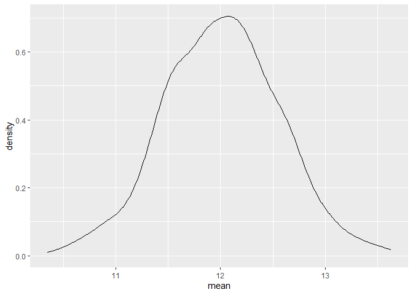
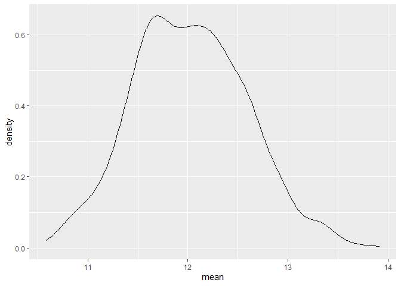
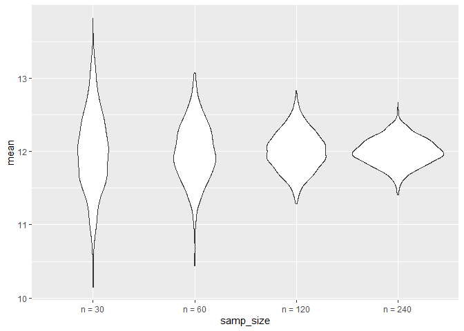
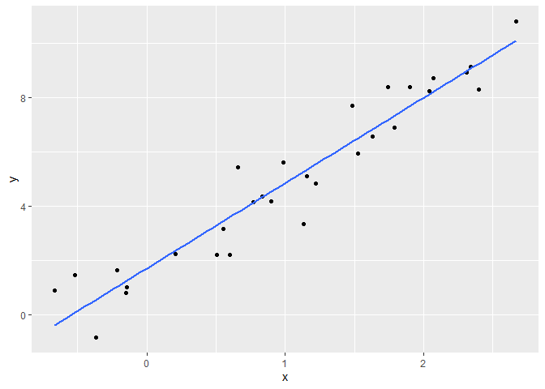
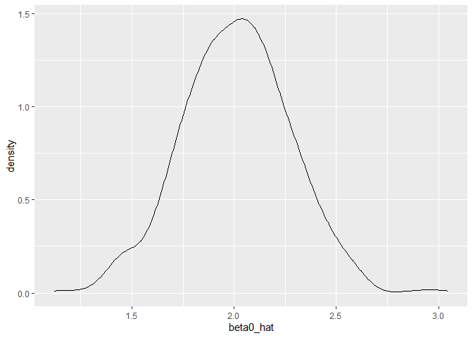

simulation
================

``` r
library(tidyverse)
```

    ## ── Attaching core tidyverse packages ──────────────────────── tidyverse 2.0.0 ──
    ## ✔ dplyr     1.2.1     ✔ readr     2.2.0
    ## ✔ forcats   1.0.1     ✔ stringr   1.6.0
    ## ✔ ggplot2   4.0.3     ✔ tibble    3.3.1
    ## ✔ lubridate 1.9.5     ✔ tidyr     1.3.2
    ## ✔ purrr     1.2.2     
    ## ── Conflicts ────────────────────────────────────────── tidyverse_conflicts() ──
    ## ✖ dplyr::filter() masks stats::filter()
    ## ✖ dplyr::lag()    masks stats::lag()
    ## ℹ Use the conflicted package (<http://conflicted.r-lib.org/>) to force all conflicts to become errors

``` r
set.seed(1236)
```

## Mean and SD

check CLT using simulation.

``` r
source("source/sim_mean_and_sd.R")
sim_mean_sd(n_obs = 30)
```

    ## # A tibble: 1 × 2
    ##    mean    sd
    ##   <dbl> <dbl>
    ## 1  12.5  2.60

``` r
output = vector("list", length = 1000)

for (i in 1:1000){
  output[[i]] = sim_mean_sd(30)
}

sim_results = bind_rows(output)
```

``` r
output |>
  bind_rows() |>
  summarize(
    emp_m = mean(mean),
    emp_se = sd(mean)
  )
```

    ## # A tibble: 1 × 2
    ##   emp_m emp_se
    ##   <dbl>  <dbl>
    ## 1  12.0  0.551

``` r
output |>
  bind_rows() |>
  ggplot(aes(x = mean)) +
  geom_density()
```

<!-- -->

Let’s do this using tibbles and maps instead.

``` r
sim_results_df = 
  tibble(
    samp_size = rep(30, 1000)
  ) |>
  mutate(
    est_df = map(samp_size, sim_mean_sd)
  ) |>
  unnest(est_df)
```

look at results.

``` r
sim_results_df |>
  ggplot(aes(x = mean)) +
  geom_density()
```

<!-- -->

## change `n`

``` r
sim_results_df = 
  expand_grid(
    samp_size = c(30, 60, 120, 240),
    iter = 1:1000
  )|>
  mutate(
    est_df = map(samp_size, sim_mean_sd)
  ) |>
  unnest(est_df)
```

``` r
sim_results_df |>
  mutate(
    samp_size = str_c("n = ", samp_size),
    samp_size = fct_inorder(samp_size)
  )|>
  ggplot(aes(x = samp_size, y = mean)) +
  geom_violin()
```

<!-- -->

``` r
sim_results_df |>
  mutate(
    samp_size = str_c("n = ", samp_size),
    samp_size = fct_inorder(samp_size)
  )|>
  group_by(samp_size) |>
  summarize(
    emp_m = mean(mean),
    emp_se = sd(mean))
```

    ## # A tibble: 4 × 3
    ##   samp_size emp_m emp_se
    ##   <fct>     <dbl>  <dbl>
    ## 1 n = 30     12.0  0.549
    ## 2 n = 60     12.0  0.391
    ## 3 n = 120    12.0  0.267
    ## 4 n = 240    12.0  0.187

## SLR

generate once

``` r
sim_data = 
  tibble(
    x = rnorm(30,1,1),
    y = 2 + 3 * x + rnorm(30,0,1)
  )
sim_data |>
  ggplot(aes(x = x, y = y)) +
  geom_point() +
  geom_smooth(method = "lm", se = FALSE)
```

    ## `geom_smooth()` using formula = 'y ~ x'

<!-- -->

``` r
fit = lm(y ~x, data = sim_data)

fit
```

    ## 
    ## Call:
    ## lm(formula = y ~ x, data = sim_data)
    ## 
    ## Coefficients:
    ## (Intercept)            x  
    ##       1.713        3.139

turn it into a function

``` r
source("source/sim_slr.R")
sim_slr(30)
```

    ## # A tibble: 1 × 2
    ##   beta0_hat beta1_hat
    ##       <dbl>     <dbl>
    ## 1      2.26      2.89

``` r
slr_results_df = 
  tibble(
    samp_size = rep(30,1000)
  ) |>
  mutate(
    est_df = map(samp_size, sim_slr)
  ) |>
  unnest(est_df)
```

``` r
slr_results_df |>
  summarize(
    b0_mean = mean(beta0_hat),
    b0_se = sd(beta0_hat)
  )
```

    ## # A tibble: 1 × 2
    ##   b0_mean b0_se
    ##     <dbl> <dbl>
    ## 1    2.01 0.266

``` r
slr_results_df |>
  ggplot(aes(x = beta0_hat)) +
  geom_density()
```

<!-- -->
